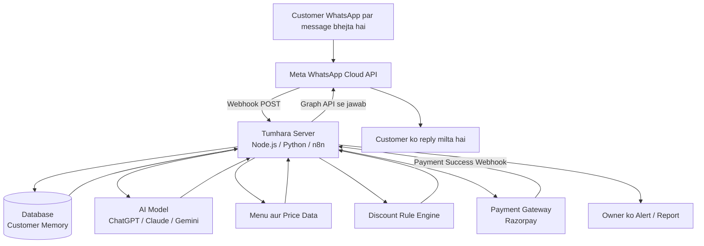

# Restaurant / Cafe WhatsApp AI Agent — COMPLETE A TO Z REPORT

**Project Idea:** Ek aisa WhatsApp Agent jo restaurant/cafe ke customers se funny tareeke se baat kare, unhe yaad rakhe, welcome bole, discount de, order le, bill par thanks bole — aur restaurant owner ka kaam asaan kar de.

**Report Date:** 13 October 2026
**Target:** India ke Restaurants, Cafes, Cloud Kitchen, Bakery, Fast-Food Outlets
**Language Note:** Ye report asaan Hinglish me likhi gayi hai taaki technical aur non-technical dono log samajh saken. Saari jaankari real hai — jo cheez mushkil hai, wo bhi sach-sach likhi hai.

---

## TABLE OF CONTENTS

1. Ye Agent Hai Kya? (Idea Samjho)
2. Agent Kya-Kya Karega? (All Features A to Z)
3. Agent Ka Funny Character (Personality Design)
4. Customer Ko Yaad Kaise Rakhega? (Memory System)
5. Discount System Kaise Kaam Karega?
6. System Kaise Kaam Karega? (Architecture)
7. API Kaise Connect Hogi? (Step-by-Step Real Setup)
8. Kaun-Kaun Si API / Tool Lagega? (Poori List)
9. 3 Tarike Banane Ke (No-Code / Low-Code / Full-Code)
10. Database Me Kya Save Hoga? (Data Design)
11. Real Example Baatein (Sample Chats)
12. Kya-Kya Hona Chahiye Tumhare Paas? (Checklist)
13. Documents Jo Lagenge (India Real)
14. Total Kharcha Kitna Aayega? (Real Cost)
15. Banane Me Kitna Time Lagega? (Timeline)
16. Payment / Bill / Thanks System Kaise Connect Hoga?
17. Asli Sachhai — Mushkilein aur Limitations (Real Talk)
18. Galtiyan Jo Log Karte Hain (Common Mistakes)
19. Restaurant Owner Ko Kaise Bechoge? (Business Plan)
20. Testing aur Go-Live Checklist
21. Phase 1, 2, 3 Roadmap (Pehle Kya, Baad Me Kya)
22. Security aur Kanooni Baatein (Privacy / Rules)
23. Glossary — Mushkil Shabdon Ke Matlab
24. Final Recommendation

---

## 1. YE AGENT HAI KYA? (IDEA SAMJHO)

Normal WhatsApp par hum insaan se chat karte hain. **WhatsApp AI Agent** ka matlab hai — restaurant ke WhatsApp number par insaan ki jagah ek smart software (AI) baitha hoga jo:

- Customer ke message ka turant jawab dega (2-3 second me, 24x7, bina thake)
- Insaan ki tarah baat karega — Hindi, English, Hinglish, teeno samjhega
- Har customer ko uske number se pehchan lega aur uski purani baatein yaad rakhega
- Khud menu dikhayega, order lega, payment link bhejega, table book karega
- Khush hoga to mazak bhi karega — matlab robot jaisa boring nahi, ek funny dost jaisa waiter

**Ek line me:** *Ye restaurant ka ek digital waiter + receptionist + cashier + marketing wala banda hai, jo WhatsApp par rehta hai aur kabhi chhutti nahi leta.*

### Restaurant Owner Ko Isse Fayda Kyun Hai?

| Problem (Aaj Ki) | Agent Ka Solution |
|---|---|
| Zomato/Swiggy 25-30% commission leta hai | WhatsApp se direct order = 0% commission, sirf payment gateway ka ~2% |
| Staff phone uthana bhool jata hai, customer chala jata hai | Agent 24x7 turant reply karta hai, ek bhi customer miss nahi |
| Customer ek baar aata hai, phir bhool jata hai | Agent offer/birthday wish bhej ke wapas bulata hai |
| Waiter busy hai, order late hota hai | Customer khud chat se order kar deta hai |
| Owner ko pata hi nahi chalta aaj kitni sale hui | Agent roz raat ko owner ko WhatsApp par report bhejta hai |

---

## 2. AGENT KYA-KYA KAREGA? (ALL FEATURES A TO Z)

### CORE FEATURES (Phase 1 — Sabse Zaruri)

**F1. Funny Welcome**
Naya customer pehli baar aaye to bada welcome, purana customer aaye to naam leke welcome.
> "Namaste Sharma Cafe me aapka dil se swagat hai! Main hoon Bablu, aapka digital waiter. Menu dikhaun ya aaj ka special bataun?"
> Purane ke liye: "Arre Rahul bhai! Namaste! 12 din baad darshan diye, hamari Cold Coffee aapko yaad kar rahi thi!"

**F2. Customer Memory (Yaad-dasht)**
Agent har customer ko yaad rakhega — naam, pasandeeda khana, last order, kitni baar aaya, veg/non-veg, mirchi kam ya zyada, birthday. Detail Section 4 me hai.

**F3. Digital Menu Dikhana**
Customer "menu" bole to photo wala menu + list milegi — category wise (Pizza, Chinese, Coffee...). Customer list me se tap karke ya type karke order kar sakta hai.

**F4. Chat Se Order Lena**
Customer jaise chahe waise order kare:
- Type karke: "2 Paneer Butter Masala, 4 Butter Naan"
- Bol ke (Voice Note): "Bhaiya ek cold coffee aur ek veg sandwich kar do"
- Photo bhej ke: Purani bill ki photo bhej de — "bhai sahab, wahi wala repeat kar do"

**F5. Smart Suggestion (AI Salah)**
Customer confuse ho — "kuch achha sa batao" — to agent uski purani pasand dekh ke bolega: "Aapko paneer pasand hai, aaj Paneer Tikka try karo, aaj fresh aaya hai!"

**F6. Discount aur Offer Dena**
Rule ke hisaab se khud sahi discount lagana. Detail Section 5 me hai.

**F7. Bill aur Payment**
Order confirm hote hi pura bill banana — item, price, GST, discount, total — aur UPI payment link bhejna (PhonePe/GPay/Paytm sab chalega).

**F8. Bill Ke Baad Thanks + Dhanyavaad Message**
Payment hote hi turant pyara sa thanks message + agli baar ka chhota offer. Detail Section 16 me hai.

**F9. Table Reservation**
"Aaj shaam 7 baje 4 logo ki table" — agent khaali table check karke booking confirm karega, aur jaane se 1 ghanta pehle yaad bhi dilayega.

**F10. Order Status Batana**
"Order ban raha hai 👨‍🍳" → "Pack ho gaya 📦" → "Rider nikal gaya hai 🛵" → "Pahunch gaya!" — har step par khabar.

### GROWTH FEATURES (Phase 2 — Customer Wapas Lane Wale)

**F11. Birthday / Anniversary Wish**
Customer ke birthday par subah khud message: "Happy Birthday Rahul ji! 🎂 Aaj Sharma Cafe ki taraf se ek dessert bilkul FREE, bas aaj aa jaiye!"

**F12. Purane Customer Ko Wapas Bulana**
Jo customer 20-30 din se nahi aaya, use khud message: "Rahul ji, kahan gayab ho gaye? Aapke liye sirf aaj 20% OFF — code: MISSYOU20"

**F13. Loyalty Points**
Har order par points. "Aapke 450 points ho gaye hain! 50 aur, aur ek coffee FREE!"

**F14. Feedback aur Google Review**
Khana khane ke 1 ghante baad: "Khana kaisa laga? 1 se 5 star dijiye."
- 4-5 star → "Dhanyavaad! Google par bhi ek review de dijiye na" (link ke saath)
- 1-3 star → Baat owner tak privately, public bura review hone se pehle problem sulajh jayegi

**F15. Roz Ka Special / Broadcast**
"Aaj ka special: Buy 1 Get 1 Pizza" — saare purane customers ko ek saath offer bhejna (lekin Meta ke rule ke hisaab se, Section 17 dekho).

**F16. Complaint Sunna aur Suljhana**
Customer gussa ho to agent shaanti se sunega, maafi mangega, aur turant owner/staff ko alert bhejega ki "Table 4 wala customer khush nahi hai, please baat karo."

### ADVANCED FEATURES (Phase 3 — Pro Level)

**F17. Table QR Order** — Har table par QR code. Scan → WhatsApp khula → table number khud pata chal gaya → wahi se order, waiter bulane ki zarurat nahi.
**F18. Party / Catering Booking** — Birthday party, kitty party, bulk order ki poori jaankari chat me lena (date, log kitne, budget).
**F19. Owner Ko Roz Report** — Raat ko owner ke WhatsApp par: "Aaj ki sale ₹24,500 | 87 orders | Sabse zyada bika: Paneer Tikka | 3 naye customer aaye."
**F20. Insaan Ko Baat Transfer (Human Handover)** — Baat agent ke bas ki na ho to chat asli staff ko de dena, customer ko pata bhi nahi chalega.
**F21. Multi-Language** — Hindi, English, Hinglish, aur zarurat ho to Marathi/Gujarati etc. Customer jis bhasha me bole, agent usi me jawab de.
**F22. Group Order** — 5 dost alag-alag apna order ek hi bill me jod saken.

---

## 3. AGENT KA FUNNY CHARACTER (PERSONALITY DESIGN)

Agent funny tabhi lagega jab uski ek **personality** banayi jaye. Ye AI ko diye jane wale nirdesh (System Prompt) se hota hai.

### Example Character: "Bablu"

- **Naam:** Bablu — Sharma Cafe ka Digital Waiter
- **Bhasha:** Hinglish (jaise aam Indian bolta hai) — "Sir, ekdum garma-garam milega!"
- **Andaaz:** Thoda mazakiya, bahut izzat-daar, kabhi badtameez nahi
- **Pasandeeda lines:** "Bilkul sahab!", "Ek number!", "Aap bas order karo, tension hum lete hain"
- **Kabhi nahi karega:** Gaali, faltu lambe joke, galat price bolna, apne mann se bada discount dena

### Real System Prompt (Example — Ye Asli Me Aisa Hi Likha Jata Hai)

```
Tum Bablu ho, Sharma Cafe, Jaipur ke digital waiter.
Tum Hinglish me baat karte ho, funny but respectful rehte ho.
Har jawab chhota rakho (2-3 line), lambe paragraph mat likho.
Customer ka naam pata ho to naam leke baat karo.
Tum sirf menu me maujud cheezon ka order loge.
Price ya discount apne mann se kabhi mat badlo — sirf system jo price de wahi bolo.
Customer naraz ho to pehle maafi mango, phir staff ko bulao.
```

> **Golden Rule:** Funny baat AI karega, lekin **paisa, price aur discount ka faisla hamesha tumhare fixed rule se hoga.** Warna AI mazaak-mazaak me kisi ko 90% off de dega aur restaurant ka nuksaan ho jayega.

---

## 4. CUSTOMER KO YAAD KAISE RAKHEGA? (MEMORY SYSTEM)

Ye is agent ka sabse kamaal wala hissa hai, aur iska raaz bahut simple hai:

**Customer ka mobile number = uski pehchan.**

Jab bhi koi message aata hai, WhatsApp khud batata hai ki message kis number se aaya hai. Agent turant database me dekhta hai — "ye number pehle aaya hai kya?"

### Database Me Har Customer Ki Ek File Banti Hai

| Kya Save Hota Hai | Example |
|---|---|
| Naam | Rahul |
| Mobile Number | 98XXXXXXXX |
| Pehli baar kab aaya | 2 Oct 2026 |
| Kitni baar aa chuka | 6 baar |
| Last Order | Paneer Butter Masala + Naan |
| Pasand | Paneer, kam mirchi, Cold Coffee |
| Veg / Non-Veg | Veg |
| Birthday | 15 March |
| Total Kitna Kharcha Kiya | ₹3,450 |
| Loyalty Points | 450 |

### Memory Ka Jadoo Example Me

- **Pehli baar:** "Namaste! Sharma Cafe me swagat hai. Aapka naam jaan sakta hoon?"
- **Dusri baar:** "Rahul bhai, namaste! Pichli baar wala Paneer Butter Masala phir se karun ya kuch naya try karenge?"
- **Baar-baar aane par:** "Sir, aap to hamare khaas mehmaan ho gaye hain — aaj ki coffee hamari taraf se!"

Bilkul jaise ek achha purana waiter apne regular customer ko pehchanta hai — bas ye software hai, isliye kabhi bhoolta nahi.

---

## 5. DISCOUNT SYSTEM KAISE KAAM KAREGA?

Discount **AI nahi dega, tumhara RULE dega.** Tum pehle se table bana ke rakhoge:

| Kab | Kisko | Kya Discount | Kaise Pata Chalega |
|---|---|---|---|
| Pehla order | Naya customer | 10% OFF (Code: WELCOME10) | Database me visit = 1 |
| 3rd order | Regular ban raha hai | 15% OFF | Database me visit = 3 |
| 5th order | Loyal customer | 1 Coffee FREE | Database me visit = 5 |
| Bill ₹999+ | Bada order | 1 Dessert FREE | Bill total check hoga |
| Birthday wala din | Birthday customer | Dessert FREE + Wish | Birthday date match |
| 30 din gayab | Wapas bulana hai | 20% OFF (Code: MISSYOU20) | Last visit 30 din purana |
| Bill time par thanks | Sabko | Agle order pe 5% ka code | Payment success ke baad |

Coupon code khud ban jata hai, customer use next order me lagata hai, system check karta hai ki code asli hai aur pehle use to nahi hua. **Ek code ek hi baar chalega** — isse koi jugaad nahi kar sakta.

---

## 6. SYSTEM KAISE KAAM KAREGA? (ARCHITECTURE)

Jab customer message bhejta hai, to peeche ye safar hota hai (2-3 second me):

```
CUSTOMER (WhatsApp)
      │  "Hi, menu bhejo"
      ▼
META / WhatsApp COMPANY KE SERVER
      │  Message ko aage bhejta hai (Webhook)
      ▼
TUMHARA AGENT SERVER (Dimaag)
      ├─► DATABASE se dekhta hai — ye Rahul hai, 6th baar aaya hai
      ├─► AI (ChatGPT type) se poochta hai — iska funny jawab banao
      ├─► MENU se price nikaalta hai
      └─► DISCOUNT RULE se offer nikaalta hai
      │  Jawab taiyaar
      ▼
META / WhatsApp SERVER
      │
      ▼
CUSTOMER ko jawab: "Rahul bhai namaste! Menu ye raha..."
```

### Mermaid Diagram (Visual Samajhne Ke Liye)



---

## 7. API KAISE CONNECT HOGI? (STEP-BY-STEP REAL SETUP)

API ka matlab simple hai — **do software ka aapas me baat karne ka tarika.** Tumhe 4-5 API jodni (connect) karni hongi. Ek-ek karke samjho:

### API 1: WhatsApp API (Sabse Important)

WhatsApp par agent chalane ke 2 asli tarike hain:

**Tarika A — BSP Company Ke Through (Beginner Ke Liye Best)**
BSP matlab WhatsApp ki official partner company. Jaise: **AiSensy, WATI, Interakt, Gupshup, Twilio.**
- Tum inki website par account banate ho, wo Meta se connection khud karwa dete hain
- Tumhe code likhne ki zarurat kam padti hai, dashboard mil jata hai
- Kharcha: lagbhag ₹999 – ₹2,500/mahina se shuru

**Tarika B — Direct Meta Cloud API (Developer Ke Liye, Sabse Sasta)**
Seedha Meta (Facebook) se connect karna. Koi beech wali company nahi.
- Bilkul free platform hai, sirf Meta ke message ka paisa lagta hai
- Lekin pura setup khud karna padta hai — coding aani chahiye
- Ye companies jaise Zomato bhi yahi use karti hain

#### Direct Meta API Setup Ke Asli Steps (Real Process)

1. **Meta Business Account banao** — business.facebook.com par restaurant ke naam se account.
2. **Meta Developer App banao** — developers.facebook.com par ek "App" banana padta hai, usme "WhatsApp" product jodo.
3. **WhatsApp Business Account (WABA) banao** — App ke andar restaurant ka business profile.
4. **Number Register karo** — Ek naya number (jo aam WhatsApp par pehle se registered NA ho, ya pehle delete kiya ho) jodo. Us par OTP aayega.
5. **Display Name set karo** — Jaise "Sharma Cafe" — Meta ise approve karta hai (1-2 din lag sakta hai).
6. **Access Token lo** — Ye ek lambi secret key (chabi) hai, isse tumhara server WhatsApp ki taraf se message bhej sakta hai. Shuru me 24 ghante wala token milta hai, phir "Permanent Token" banaya jata hai (System User bana ke).
7. **Webhook Set karo** — Ye sabse important step hai:
   - Apne server ka ek public URL (jaise `https://mere-server.com/webhook`) Meta ko dena padta hai
   - Meta ek secret shabda (Verify Token) se check karega ki server tumhara hi hai — Meta GET request bhejega jisme `hub.mode`, `hub.verify_token`, `hub.challenge` aayega; tumhara server sahi token par challenge wapas bhejega, tab connection pakka hota hai
   - Uske baad jab bhi customer message karega, Meta tumhare server ko **POST** request bhejega
8. **Message Bhejna** — Tumhara server is address par request bhejke jawab deta hai:
   ```
   POST https://graph.facebook.com/v21.0/{phone-number-id}/messages
   Header: Authorization: Bearer {TUMHARA_ACCESS_TOKEN}
   Body: { "messaging_product": "whatsapp", "to": "91XXXXXXXXXX",
           "type": "text", "text": { "body": "Namaste! Menu ye raha..." } }
   ```
   *(v21.0 version hai — naye version aate rehte hain, Meta docs me hamesha latest check karna.)*
9. **Aane Wale Message Ko Padhna** — Webhook par aisa data aata hai (real format):
   ```json
   { "entry": [{ "changes": [{ "value": {
       "messages": [{ "from": "91XXXXXXXXXX", "type": "text",
                      "text": { "body": "2 pizza kar do" } }],
       "contacts": [{ "wa_id": "91XXXXXXXXXX",
                      "profile": { "name": "Rahul Sharma" } }]
   } }] }] }
   ```
   Yahi `from` number hi customer ki pehchan hai — isi se database me uski file khulti hai.

#### WhatsApp Ke 2 Khass Rule (Bhoolna Mat)

- **24 Ghante Ki Khidki (Customer Service Window):** Customer message kare to 24 ghante tak tum FREE me kitne bhi jawab de sakte ho. 24 ghante baad khud se message bhejna ho to approved **Template Message** lagega jiski fees lagti hai.
- **Template Approval:** Offer/reminder wale message pehle Meta se approve karane padte hain. "Hello {{1}}, aapke liye {{2}}% off hai" — aisa format. Approval aam taur par kuch minutes se kuch ghanto me mil jata hai.

### API 2: AI API (Agent Ka Dimaag)

- **Kya lagega:** OpenAI (ChatGPT) / Anthropic (Claude) / Google (Gemini) — kisi ek ki API Key.
- **Connect kaise hoti hai:** Inki website par account → Payment method → API Key (secret chabi) milti hai → Tumhare code/n8n me wo key daalte ho.
- **Kaam:** Customer ka message AI ko bhejna + apna System Prompt (Bablu wali personality) + database se uski purani baat. AI funny jawab bana ke deta hai.
- **Kharcha:** Pay-as-you-go — jitni baat, utna paisa. Ek customer chat ka lagbhag ₹0.5 – ₹3 padta hai (model ke hisaab se; chhote model saste hain).
- **Sastा Jugaad:** Gemini ke kuch model ka free tier testing ke liye mil jata hai.

### API 3: Database (Yaad-dasht)

| Option | Kiske Liye | Kharcha |
|---|---|---|
| Google Sheet | Bilkul shuruaat, demo | Free |
| Supabase | Asli product (Postgres database) | Free tier se shuru, phir ~₹2,000/mah |
| Firebase | Google wala option | Free tier se shuru |

Connect karna matlab — tumhara server har message par database se poochhega: "Is number wala customer kaun hai, last order kya tha?"

### API 4: Payment API (Bill Ke Liye)

- **Company:** Razorpay ya Cashfree (dono Indian, UPI ke king).
- **Kaise kaam karta hai:** Agent order total bana ke Razorpay ki API se ek **Payment Link** banata hai → Customer ko WhatsApp par link → Customer UPI se pay karta hai → Razorpay tumhare server ko **Webhook** se khabar deta hai "Payment Success!" → Agent turant Thanks message bhejta hai.
- **Asli API call (example):**
  ```
  POST https://api.razorpay.com/v1/payment_links
  Body: { "amount": 64000, "currency": "INR",
          "description": "Sharma Cafe Order #123" }
  ```
  Note: Paisa paise me likha jata hai — ₹640 = 64000.
- **Fees:** Razorpay lagbhag 2% per transaction. KYC lagega (PAN, Bank account, GST agar hai to).

### API 5: Billing / POS API (Optional, Phase 2)

Restaurant me jo billing software chalta hai (jaise **Petpooja, Posist, Rista**) — agar uski API mil jaye to order seedha billing system me chala jayega aur bill wahi se banega. **Sachhai:** Har POS API nahi deta; kuch ke liye unse baat karke permission leni padti hai. Shuruaat me bina POS ke, agent khud bill bana de — kaam chal jata hai.

### n8n — Bina Zyada Code Ke API Jodne Wala Tool

Agar coding kam aati hai to **n8n** naam ka free tool hai jo saari API ko phool-mala ki tarah jod deta hai (ek box se dusra box):

```
[WhatsApp Message Aaya] → [Google Sheet me Customer Dhundo]
→ [ChatGPT se Jawab Banao] → [Discount Check Karo]
→ [WhatsApp Par Jawab Bhejo] → [Sheet Me Save Karo]
```

Yehi kaam **Make.com** bhi karta hai. Apne laptop par n8n free chalta hai; online chalana ho to server lagega.

---

## 8. KAUN-KAUN SI API / TOOL LAGEGA? (POORI LIST)

| # | Cheez | Kis Kaam Ke Liye | Zaruri Hai? |
|---|---|---|---|
| 1 | WhatsApp Business Platform (Meta) ya BSP (AiSensy/WATI) | Message bhejna-lena | ✅ Ha, sabse zaruri |
| 2 | OpenAI / Gemini / Claude API | AI se baat karwana | ✅ Ha |
| 3 | Supabase ya Google Sheet | Customer yaad rakhna | ✅ Ha |
| 4 | n8n ya Python/Node.js Server | Saara dimaag chalana | ✅ Ha (koi ek) |
| 5 | Razorpay / Cashfree | UPI Payment Link | ✅ Order ke liye |
| 6 | Server Hosting (Render/Railway/VPS) | Agent ko 24x7 online rakhna | ✅ Ha |
| 7 | POS (Petpooja) API | Billing me direct entry | ❌ Baad me |
| 8 | Google Review Link | Khush customer se review | ❌ Baad me (free hai) |

---

## 9. 3 TARIKE BANANE KE

### Tarika 1: No-Code (Coding Bilkul Nahi)
**Tools:** AiSensy/WATI + inke andar ka Chatbot Builder + ChatGPT wala feature + Google Sheet
**Time:** 3-5 din me basic agent taiyaar
**Fayda:** Sabse jaldi, koi coding nahi
**Nuksaan:** Mahina fees zyada, funny memory wala system thoda limited रहेगा, zyada custom kaam mushkil

### Tarika 2: Low-Code (Thodi Samajh) ⭐ RECOMMENDED
**Tools:** n8n + Meta Cloud API (direct) + Gemini/ChatGPT + Supabase/Google Sheet + Razorpay
**Time:** 7-10 din me full MVP
**Fayda:** Sasta, powerful, memory + discount + payment sab ho jayega
**Nuksaan:** n8n seekhne me 3-4 din lagenge (YouTube se seekh sakte ho)

### Tarika 3: Full-Code (Developer Style)
**Tools:** Python (FastAPI) ya Node.js (Express) + PostgreSQL + Redis + Docker + VPS Server
**Time:** 3-4 hafte me pro product
**Fayda:** Poora control, 100 restaurants ko ek saath chala sakte ho, bechne layak SaaS product banta hai
**Nuksaan:** Coding aani chahiye ya developer rakhna padega

---

## 10. DATABASE ME KYA SAVE HOGA? (DATA DESIGN)

Asli product me ye tables banengi (naam sun ke daro mat, ye bas list hain):

**1. customers (Customer ki file)**
`id, phone (asli pehchan), name, birthday, veg_or_nonveg, total_visits, total_spent, loyalty_points, last_visit_date, created_at`

**2. menu_items (Menu)**
`id, name, price, category, is_veg, is_available, description`

**3. orders (Orders)**
`id, customer_phone, items_detail, total_amount, discount_applied, payment_status, order_status, created_at`

**4. coupons (Discount codes)**
`id, code, discount_percent, customer_phone, is_used, expiry_date`

**5. reservations (Table booking)**
`id, customer_phone, date, time, persons, status`

**6. feedback (Review)**
`id, customer_phone, rating_star, comment, created_at`

---

## 11. REAL EXAMPLE BAATEIN (SAMPLE CHATS)

### Chat 1: Naya Customer — Welcome + Order + Bill + Thanks

> **Customer:** Hi
> **Bablu 🤖:** Namaste sahab! Sharma Cafe me aapka dil se swagat hai 🙏 Main Bablu, aapka digital waiter. Menu dikhaun ya aaj ka special bataun?
> **Customer:** Menu bhejo
> **Bablu:** Ye raha menu sir! Waise aaj Paneer Tikka ekdum taaza aaya hai, try karne layak hai 😋 Order type kar dijiye, main note kar leta hoon.
> **Customer:** 2 paneer butter masala, 4 butter naan
> **Bablu:** Ek number order sir! Aur pehli baar aane ki khushi me aapko **10% OFF** mila hai (WELCOME10) 🎉
> Bill: ₹720 → ₹648. Payment ke liye ye raha UPI link, 2 minute me confirm ho jayega.
> **Customer:** *(Pay kar deta hai)*
> **Bablu:** Dhanyavaad sahab! 🙏 Payment mil gaya, order kitchen me chala gaya hai. Khana bane to bahar ki khushboo, aap aaye to cafe me bahar aayi! 25-30 min me taiyaar. Aapke agle order ke liye ek chhota sa tohfa code bhej raha hoon: NEXT5 🎁

### Chat 2: Purana Customer — Yaad + Funny + Loyalty

> **Customer:** Hi
> **Bablu:** Arre Rahul bhai, namaste! 12 din baad darshan diye — hamari Cold Coffee to aapka pooch-pooch ke thak gayi! 😄 Pichli baar wali hi karun ya kuch naya try karenge?
> **Rahul:** Wahi wala kar do, aur ek sandwich bhi
> **Bablu:** Ho gaya bhai! Waise khushkhabri — aapke 480 loyalty points ho gaye hain, bas 20 aur aur ek coffee bilkul FREE. Ye order mila ke aap FREE coffee ke hakdaar ho jayenge! ☕

### Chat 3: Naraz Customer — Complaint

> **Customer:** Khana bahut thanda tha, bilkul bakwaas
> **Bablu:** Sir, dil se maafi chahta hoon 🙏 Ye hamari galti hai, aisa nahi hona chahiye tha. Main abhi manager sahab ko bhej raha hoon aapke paas, aur aaj ka dessert hamari taraf se bilkul free. Aapka mood kharab hua, iske liye sach me sorry.
> *(Peeche se turant Owner ko alert: "Rahul (98XXX) khush nahi hai — khana thanda. Please turant baat karein.")*

---

## 12. KYA-KYA HONA CHAHIYE TUMHARE PAAS? (CHECKLIST)

- [ ] Ek **naya mobile number / SIM** — sirf agent ke liye (personal number nahi)
- [ ] Ek **Facebook (Meta) account** — business banane ke liye
- [ ] Restaurant ka **naam, address, aur ek email ID**
- [ ] Ek **laptop/computer** aur internet
- [ ] Restaurant ka **menu** (ek kagaz ki photo bhi chalegi shuruaat me, phir list banani hai)
- [ ] **Discount rules** soch ke rakhe (Section 5 wale table jaisi)
- [ ] Payment ke liye **Bank account + PAN card** (Razorpay KYC ke liye)
- [ ] Shuruaat ka budget: Demo FREE, asli setup ke liye ₹2,000 – ₹5,000

**Skill ki baat:** Agar tumhe coding nahi aati, to bhi Tarika 1 ya 2 se bana sakte ho. Bas computer chalana aur YouTube dekh ke seekhne ka patience chahiye.

---

## 13. DOCUMENTS JO LAGENGE (INDIA — REAL)

| Kaam | Document |
|---|---|
| Meta Business Verification (zyada message limit ke liye) | Business ka proof — GST Certificate / Shop Act (Gumasta) / Udyam Registration / Bijli ka bill business ke naam |
| Display Name Approval | Naam restaurant ke asli naam se milta ho |
| Razorpay / Cashfree KYC | PAN Card, Bank Statement/Cancelled Cheque, Aadhaar (proprietor ka), GST (agar hai) |
| SIM lene ke liye | Aadhaar Card |

> Note: Shuruaat me bina business verification ke bhi kaam chal jata hai, lekin roz ke message ki limit kam rehti hai (shuru me 250, phir acchi quality par 1,000 tak badhti hai). Bade restaurant ke liye verification karana behtar hai — 2 se 7 din lag sakte hain.

---

## 14. TOTAL KHARCHA KITNA AAYEGA? (REAL COST — INDIA)

| Cheez | Muft Tarika | Paid / Asli Tarika |
|---|---|---|
| WhatsApp API (AiSensy/WATI) | Free Trial (7-14 din) | ₹999 – ₹2,500 / mahina |
| Meta ke message ka charge | Demo me test number par free | India me lagbhag: Marketing msg ~₹0.86, Utility msg ~₹0.13, Chat ke jawab zyadaatar 24 ghante window me FREE. *(Rates badalte rehte hain — Meta ki website par hamesha latest check karna)* |
| AI (ChatGPT/Gemini) | Gemini free tier testing ke liye | ₹500 – ₹2,000 / mahina (customer ke hisaab se) |
| Database (Supabase/Sheet) | Google Sheet FREE / Supabase free tier | ~₹0 – ₹2,000 / mahina |
| Server (n8n/app chalane ko) | Apne laptop par FREE | ₹400 – ₹1,500 / mahina (Render/Railway/VPS) |
| Payment Gateway | — | Setup free, per order ~2% fees |
| **TOTAL (1 restaurant, shuruaat)** | **₹0 (demo)** | **lagbhag ₹2,000 – ₹5,000 / mahina** |

---

## 15. BANANE ME KITNA TIME LAGEGA? (TIMELINE)

| Din | Kaam |
|---|---|
| Din 1-2 | Number leke Meta/BSP account banana, naam approve karwana |
| Din 3 | Menu ki digital list taiyaar karna |
| Din 4-5 | Agent banana — Welcome, Menu, Order wala flow |
| Din 6 | Customer memory (Database) jodna |
| Din 7 | Discount rule + Bill + Razorpay payment link |
| Din 8 | Funny personality (System Prompt) theek karna, testing |
| Din 9 | Apne doston se test karwana, galti sudharna |
| Din 10 | **Ek asli cafe me trial shuru** 🎉 |
| Hafte 3-4 | Feedback, Reservation, Owner report, QR table order |

---

## 16. PAYMENT / BILL / THANKS SYSTEM KAISE CONNECT HOGA?

Ye poora safar khud-ba-khud (automatic) hota hai:

```
1. Customer order confirm karta hai
2. Agent Database/Menu se sahi price nikaal ke bill banata hai
      (AI price nahi banata — galti ka koi chance nahi)
3. Agent Razorpay API ko bolta hai — "₹648 ka payment link banao"
4. Razorpay link deta hai → Agent customer ko WhatsApp par bhejta hai
5. Customer UPI (GPay/PhonePe) se pay karta hai
6. Razorpay Agent ke server ko Webhook se bolta hai — "Payment SUCCESS ✅"
7. Agent turant Thanks message + agli baar ka offer code bhejta hai
8. Saath me Kitchen/Owner ko bhi alert: "Naya order #123 — 2 Paneer Masala, 4 Naan"
```

**Thanks Message Example:**
> "Bahut-bahut dhanyavaad Rahul ji! 🙏 Aapka pyaar hi Sharma Cafe ki asli kamai hai. Phir jaldi aaiyega — Bablu intezaar karega! Aapke liye agle order ka tohfa code: **THANKS5** 🎁"

---

## 17. ASLI SACHHAI — MUSHKILEIN AUR LIMITATIONS (REAL TALK)

Koi tumhe ye nahi batayega, lekin main sach bata raha hoon:

1. **WhatsApp band ho sakta hai agar spam kiya** — Bina customer ki permission ke faltu offer message bhejoge to number ki "Quality" gir jayegi aur Meta number block kar sakta hai. Rules: sirf unhi ko offer bhejo jo pehle aa chuke hain / haan bole hain, aur har message me "STOP" likhne par message band karna padega.
2. **24 ghante ka rule** — Customer chup hai to agent khud se free chat nahi kar sakta. Template message lagega jiski fees hai aur approval bhi lagega.
3. **AI kabhi-kabhi galti karega** — AI kuch ulta-pulta bol sakta hai. Isliye price/discount/menu hamesha fixed data se aayega, AI sirf baat banayega. Shuru ke dino me ek insaan chats par nazar rakhega.
4. **Naam approve hone me time lagta hai** — Meta display name aur template kabhi-kabhi reject kar deta hai. 1-2 baar try karna pad sakta hai — ye normal hai, ghabrana mat.
5. **Har restaurant ka billing software API nahi deta** — Chhote cafe me bill agent hi banayega; bade restaurant me POS jodne me unki company se baat karni padegi.
6. **Internet/server down ho to agent band** — Isliye achhi hosting leni padti hai, aur ek backup plan (staff ka number) rakhna chahiye.
7. **Customer ka data surakshit rakhna tumhari zimmedari hai** — Naam-number bechna ya leak karna India ke DPDP kanoon ke khilaf hai. Access Token (chabi) kabhi kisi ko mat dena, kabhi code me khule aam mat likhna.

**Sach ye hai:** Ye sab mushkilein hal ho jati hain. Hazaaro Indian restaurant aise agent chala rahe hain. Bas sahi tarike se, rule maan ke kaam karna padta hai.

---

## 18. GALTIYAN JO LOG KARTE HAIN (COMMON MISTAKES)

- ❌ Apna personal WhatsApp number use karna → baad me number band hua to personal chat bhi gaya. Hamesha alag number.
- ❌ AI ko price aur discount ka malik bana dena → hamesha fixed rule rakho.
- ❌ Pehle din se 10,000 logo ko offer spam karna → number band. Dheere-dheere, permission se.
- ❌ Test kiye bina seedha restaurant me laga dena → pehle doston se 1 hafta test karo.
- ❌ Access Token ko code me likh ke GitHub par daal dena → chabi chori ho jayegi. Hamesha `.env` file me chhupao.
- ❌ Insaan ka option hi na rakhna → customer ko "staff se baat karni hai" ka rasta hamesha do.

---

## 19. RESTAURANT OWNER KO KAISE BECHOGE? (BUSINESS PLAN)

Agar tum ye agent bana ke restaurants ko bechna chahte ho:

**Tumhari Kamai Ka Model:**

| Kya Charge Karoge | Kitna |
|---|---|
| Ek baar ka Setup Fee | ₹9,999 – ₹24,999 (ek restaurant se) |
| Har Mahine ki Fees | ₹1,999 – ₹4,999 / restaurant |
| Extra: Menu photo-shoot, QR printing | Alag charge |

**Hisab:** Sirf 10 restaurant mil jaye = har mahine ₹20,000 – ₹50,000 fix aane wala paisa (recurring income).

**Owner Ko Bolne Wali Line (Pitch):**
> "Sir, Zomato aapse 25% leta hai. Main aapko aapka khud ka WhatsApp waiter deta hoon — order direct aapke paas, customer aapka khud ka, commission zero. Customer ko wo by naam yaad rakhega aur birthday par bulayega bhi. Ek hafta free trial laga deta hoon, pasand aaye tab paisa dena."

**Beche Ka Tarika:** Pehle ek cafe me free trial lagao → uske order badhne do → uski video/story bana ke dusro ko dikhao → phir aas-paas ke 10 cafe pakdo.

---

## 20. TESTING AUR GO-LIVE CHECKLIST

Lagaane se pehle ye sab tick karna:

- [ ] Naye customer ko welcome sahi ja raha hai?
- [ ] Purane customer ko agent naam se pehchan raha hai?
- [ ] Menu ke price bilkul sahi a rahe hain?
- [ ] Discount sirf rule ke hisaab se lag raha hai? (Galat code par reject hota hai?)
- [ ] Payment link khulta hai aur pay karne par Thanks message aata hai?
- [ ] Naraz customer par owner ko alert ja raha hai?
- [ ] "Staff se baat karni hai" bolne par asli insaan ko chat milti hai?
- [ ] Hindi me bolne par agent Hindi me jawab deta hai?
- [ ] Voice note bhej ke test kiya?
- [ ] Ek hi code do baar use karke dekha (nahi chalna chahiye)?

---

## 21. PHASE 1, 2, 3 ROADMAP

| Phase | Kya Banega | Kab |
|---|---|---|
| **Phase 1 (MVP)** | Welcome, Memory, Menu, Order, Bill, Payment, Thanks, Discount | Pehle 10 din |
| **Phase 2 (Growth)** | Reservation, Feedback+Google Review, Birthday Wish, Purano Ko Wapas Bulana, Loyalty Points | Hafte 3-4 |
| **Phase 3 (Pro)** | Table QR Order, Owner Daily Report, Complaint Alert, Party Booking, 2nd Branch | Mahine 2-3 |

---

## 22. SECURITY AUR KANOONI BAATEIN

- Customer ko pehla offer message bhejne se pehle uski **ha** (opt-in) lo — "Kya hum aapko offers bhein? HAAN likh ke bhejein."
- Har broadcast me **STOP** ka option do; STOP aate hi use list se hatao.
- Token, API Key hamesha server ki secret jagah (`.env`) me rakho, kisi ke saath share mat karo.
- Customer data sirf order ke kaam ke liye use karo — DPDP Act, 2023 (India ka data kanoon) yahi kehta hai.
- Meta ki **WhatsApp Business Policy** aur **Commerce Policy** follow karo — sharaab/tambaku jaisi cheezo ka promotion WhatsApp par mana hai.

---

## 23. GLOSSARY — MUSHKIL SHABDON KE MATLAB

| Shabd | Matlab (Simple) |
|---|---|
| API | Do software ka aapas me baat karne ka tarika |
| Webhook | "Jab ye ho, to mujhe turant khabar kar do" wala system |
| Access Token | Secret chabi jisse server WhatsApp ki taraf se message bhejta hai |
| BSP | WhatsApp ki official partner company (AiSensy, WATI type) |
| Template Message | Meta se pehle approve karaya hua message (offer/reminder ke liye) |
| 24-Hour Window | Customer ke message ke baad 24 ghante ki free chat ki khidki |
| LLM / AI Model | ChatGPT jaisa dimaag jo bhasha samjhta hai |
| System Prompt | AI ko di gayi hidayat — "tum kaun ho, kaise baat karni hai" |
| Database | Computer wali register-book jahan sab data save hota hai |
| Payment Gateway | Razorpay jaisi company jo UPI se paisa leke deti hai |
| Webhook (Payment) | Payment hote hi Razorpay ki taraf se aane wali khabar |
| n8n | Bina zyada code ke API ko jodne wala free tool |
| SaaS | Har mahine fees leke software ki service dena |

---

## 24. FINAL RECOMMENDATION

1. **Shuru FREE demo se karo** — Meta ke test number + Gemini free AI + Google Sheet. Paisa lagane se pehle agent ko baat karte hue dekho.
2. **Tarika 2 (n8n wala) apnao** — Coding nahi aati to yahi sabse acha rahega, sasta bhi, powerful bhi.
3. **Pehle 1 cafe, phir duniya** — Ek asli cafe me ek mahina chalao, uske asli number (orders, repeat customer) ikatthe karo. Wahi tumhara sabse bada saboot hoga dusre restaurant ko bechne ke liye.
4. **Paisa price se nahi, yaad-dasht se banta hai** — Funny baat customer ko hasayegi, lekin **yaad rakhna + birthday wish + sahi discount** hi usey baar-baar wapas layega. Isi par sabse zyada dhyan dena.

> **Aakhri baat:** Ye koi jaadu nahi hai — ye ek asli, bannay jaane wala product hai jo aaj India me hazaaro restaurant chala rahe hain. Number lo, account banao, pehla "Namaste" wala message chalao — baaki sab raste me banta jayega.

---

*Report taiyaar — Restaurant/Cafe WhatsApp AI Agent ki A to Z jaankari. Is report ko samajh ke koi bhi beginner apna pehla agent banana shuru kar sakta hai.*
